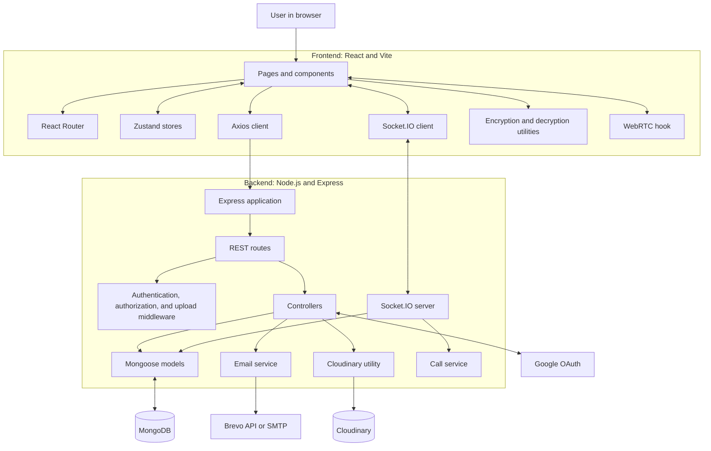
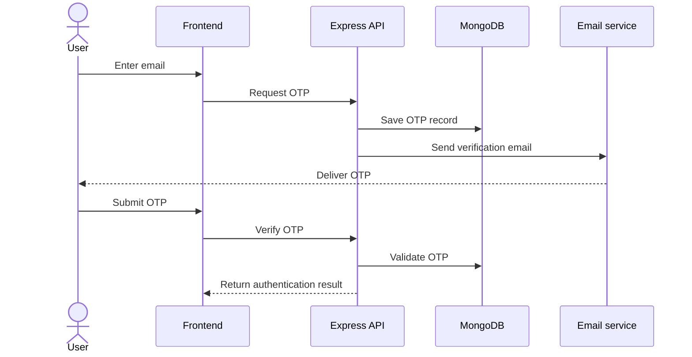
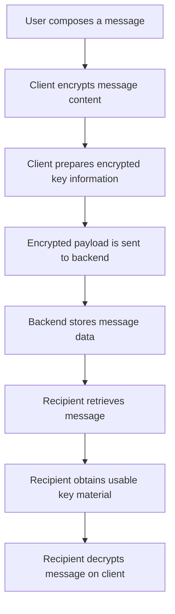

# Connecto

**Connecto** is a full-stack, real-time messaging web application built with React, Vite, Node.js, Express, MongoDB, and Socket.IO. It brings together one-to-one and group conversations, account verification, message interactions, media sharing, device management, audio/video calling, and an administration dashboard.

## Table of Contents

- [Overview](#overview)
- [Features](#features)
- [Technology Stack](#technology-stack)
- [Architecture](#architecture)
- [Project Structure](#project-structure)
- [How It Works](#how-it-works)
- [Database Models](#database-models)
- [Getting Started](#getting-started)
- [Environment Configuration](#environment-configuration)
- [Available Scripts](#available-scripts)
- [Security Considerations](#security-considerations)
- [Implementation Notes](#implementation-notes)
- [Future Improvements](#future-improvements)
- [Author](#author)

## Overview

Connecto is designed to provide a single place for real-time communication. The React frontend handles the user interface, navigation, local state, encryption utilities, and call interface. The Express backend provides REST APIs, authentication and authorization middleware, database access, upload handling, and application logic. Socket.IO supports real-time events, while WebRTC is used for audio/video media when a peer connection can be established.

MongoDB stores application data through Mongoose models. The project also integrates with external services for email delivery, Google authentication, and media storage.

## Features

### Authentication and account setup

- Email-based OTP verification.
- Send, resend, cancel, and verify OTP operations.
- Google OAuth sign-in.
- Authentication checks and protected frontend routes.
- Token/session-related backend operations.
- Profile setup and onboarding.

### Messaging and conversations

- One-to-one conversations.
- Group conversations.
- Message sending and retrieval.
- Message replies and reactions.
- Message editing and deletion.
- Delivery and read-receipt information.
- Pinned messages and chat pinning.
- Media and document browsing.
- Chat clearing and message deletion metadata.
- System messages for supported group events.

### Group management

- Create groups with a name and optional avatar.
- Add and remove members.
- Promote or demote members between admin and member roles.
- Update supported group details and settings.

### Profiles and privacy

- Profile setup and editing.
- Avatar upload and update.
- Username availability checks, search, and profile lookup.
- Online status and last-seen information.
- Block users and chats.
- View and manage the block list.
- Account and profile status fields.

### Device and key management

- Register and list devices.
- Select a primary device.
- Log out or remove a device.
- Update device pre-keys.
- Synchronize device information.
- Backend endpoints for encrypted private-key backup and retrieval.

### Audio and video calls

- Start calls.
- Accept or reject incoming calls.
- End calls and mark missed calls.
- View call history.
- Socket.IO signaling and WebRTC media handling.

### Administration

- Overview statistics.
- User management.
- Call and media statistics.
- Activity summaries.
- Top-entity statistics.
- Promote or demote users.
- Export user summary data.

The backend contains endpoints for these capabilities. Whether a particular action is available to a user depends on the frontend interface and the applicable authorization rules.

## Technology Stack

### Frontend

| Technology | Purpose |
| --- | --- |
| React 19 | Builds the user interface from reusable components. |
| Vite | Provides the development server and production build tooling. |
| React Router DOM | Handles client-side navigation. |
| Zustand | Manages shared application state. |
| Axios | Sends HTTP requests to the backend. |
| Socket.IO Client | Receives and sends real-time events. |
| Tailwind CSS | Provides utility-based styling. |
| Radix UI | Provides accessible interface primitives used by the UI. |
| Framer Motion | Adds interface animations. |
| TweetNaCl | Provides cryptographic operations used by the application. |
| CryptoJS | Provides cryptographic utility functions used by the application. |
| WebRTC browser APIs | Support real-time audio/video media. |
| Recharts | Renders dashboard charts. |
| `react-dropzone`, `file-saver`, `jszip`, `dom-to-image-more` | Provide file selection or export-related utilities present in the frontend dependencies. |

### Backend

| Technology | Purpose |
| --- | --- |
| Node.js | Runs the backend JavaScript application. |
| Express 5 | Defines the REST API and middleware pipeline. |
| MongoDB | Stores application data. |
| Mongoose | Defines schemas and interacts with MongoDB. |
| Socket.IO | Provides real-time communication and signaling events. |
| `jsonwebtoken` | Supports JWT-related authentication. |
| Google Auth Library and Arctic | OAuth-related dependencies. |
| Cloudinary | Provides media storage integration. |
| Multer | Handles multipart file uploads. |
| Brevo REST API and Nodemailer | Provide the email delivery paths used by the supplied email service. |
| `dotenv` | Loads environment configuration. |
| `cors` | Configures cross-origin access. |
| `cookie-parser` | Parses cookies in incoming requests. |
| `bcryptjs` | Password-hashing dependency included in the backend package. |

## Architecture

The frontend communicates with the backend through HTTP requests and a Socket.IO connection. The backend uses Mongoose to access MongoDB and integrates with external services for email delivery, OAuth, and media storage.



This is a logical architecture diagram, not a deployment diagram. It does not imply that the application is hosted on a particular production provider.

## Project Structure

The following structure reflects the repository tree supplied for Connecto. Repeated theme styles and reusable UI primitives are grouped in the explanation after the tree.

```text
rohansantra-connecto/
├── backend/
│   ├── package.json
│   ├── .env.sample
│   ├── public/
│   │   └── temp/
│   │       └── .gitKeep
│   └── src/
│       ├── app.js
│       ├── constants.js
│       ├── index.js
│       ├── controllers/
│       │   ├── admin.controller.js
│       │   ├── auth.controller.js
│       │   ├── block.controller.js
│       │   ├── call.controller.js
│       │   ├── chat.controller.js
│       │   ├── devices.controller.js
│       │   ├── message.controller.js
│       │   └── profile.controller.js
│       ├── db/
│       │   └── index.js
│       ├── middlewares/
│       │   ├── admin.middleware.js
│       │   ├── auth.middleware.js
│       │   ├── error.middleware.js
│       │   └── multer.middleware.js
│       ├── models/
│       │   ├── block.model.js
│       │   ├── call.model.js
│       │   ├── chat.model.js
│       │   ├── chatMember.model.js
│       │   ├── device.model.js
│       │   ├── message.model.js
│       │   ├── otp.model.js
│       │   ├── pin.model.js
│       │   ├── profile.model.js
│       │   ├── session.model.js
│       │   └── user.model.js
│       ├── routes/
│       │   ├── admin.routes.js
│       │   ├── auth.routes.js
│       │   ├── block.routes.js
│       │   ├── call.routes.js
│       │   ├── chat.routes.js
│       │   ├── devices.routes.js
│       │   ├── message.routes.js
│       │   └── profile.routes.js
│       ├── services/
│       │   ├── call.service.js
│       │   └── email.js
│       ├── socket/
│       │   └── index.js
│       └── utils/
│           ├── ApiError.js
│           ├── ApiResponse.js
│           ├── asyncHandler.js
│           ├── block.utils.js
│           ├── cloudinary.js
│           └── token.js
└── frontend/
    ├── README.md
    ├── components.json
    ├── eslint.config.js
    ├── index.html
    ├── jsconfig.json
    ├── package.json
    ├── vercel.json
    ├── vite.config.js
    ├── .env.sample
    └── src/
        ├── App.jsx
        ├── constants.js
        ├── main.jsx
        ├── api/
        │   └── axios.js
        ├── components/
        │   ├── admin/
        │   │   ├── ActivitySection.jsx
        │   │   ├── CallsSection.jsx
        │   │   ├── Chart-wrappers.jsx
        │   │   ├── MediaSection.jsx
        │   │   ├── OverviewSection.jsx
        │   │   ├── TopEntitiesSection.jsx
        │   │   └── UserManagementSection.jsx
        │   ├── app/
        │   │   ├── AppShell.jsx
        │   │   ├── ChatArea.jsx
        │   │   └── Sidebar.jsx
        │   ├── auth/
        │   │   ├── AuthEmailForm.jsx
        │   │   └── OTPForm.jsx
        │   ├── calls/
        │   │   ├── CallButton.jsx
        │   │   ├── CallDetailsPanel.jsx
        │   │   ├── GlobalCallUI.jsx
        │   │   ├── InCallPanel.jsx
        │   │   ├── IncomingCallDialog.jsx
        │   │   ├── OutgoingCallDialog.jsx
        │   │   └── RejoinCallOverlay.jsx
        │   ├── chat/
        │   │   ├── BlockBanner.jsx
        │   │   ├── ChatDetailsPanel.jsx
        │   │   ├── ChatListItem.jsx
        │   │   ├── ChatMenuDropdown.jsx
        │   │   ├── EmojiInfoPanel.jsx
        │   │   ├── FileViewer.jsx
        │   │   ├── MediaDocsOverlay.jsx
        │   │   ├── MediaGalleryManager.jsx
        │   │   ├── MessageComposer.jsx
        │   │   ├── MessageInfoPanel.jsx
        │   │   ├── MessageItem.jsx
        │   │   ├── MessageList.jsx
        │   │   ├── MessageMenu.jsx
        │   │   ├── NewChatOverlay.jsx
        │   │   ├── NewGroupOverlay.jsx
        │   │   ├── PinnedMessagesBar.jsx
        │   │   ├── QuickReactions.jsx
        │   │   └── SeekableWaveform.jsx
        │   ├── common/
        │   │   ├── ConnectoBrandAndSlogan.jsx
        │   │   ├── ConnectoLogo.jsx
        │   │   ├── EmptyState.jsx
        │   │   ├── Illustration.jsx
        │   │   ├── LoaderScreen.jsx
        │   │   └── ShortcutsModal.jsx
        │   ├── settings/
        │   │   ├── AboutSection.jsx
        │   │   ├── BlockedSection.jsx
        │   │   ├── DevicesSection.jsx
        │   │   ├── PrivacySection.jsx
        │   │   ├── ProfileSection.jsx
        │   │   ├── ShortcutsSection.jsx
        │   │   └── appearance/
        │   │       ├── AppearanceSection.jsx
        │   │       ├── ThemeCard.jsx
        │   │       └── ThemeFilters.jsx
        │   ├── Skeleton/
        │   │   ├── ActivitySectionSkeleton.jsx
        │   │   ├── CallHistorySkeleton.jsx
        │   │   ├── CallsSectionSkeleton.jsx
        │   │   ├── ChatAreaSkeleton.jsx
        │   │   ├── ChatListSkeleton.jsx
        │   │   ├── DevicesSectionSkeleton.jsx
        │   │   ├── MediaGallerySkeleton.jsx
        │   │   ├── MediaSectionSkeleton.jsx
        │   │   ├── MessageItemSkeleton.jsx
        │   │   ├── MessageListSkeleton.jsx
        │   │   ├── OverviewSectionSkeleton.jsx
        │   │   ├── TopEntitiesSectionSkeleton.jsx
        │   │   └── UserManagementSectionSkeleton.jsx
        │   └── ui/
        │       ├── alert-dialog.jsx
        │       ├── avatar.jsx
        │       ├── badge.jsx
        │       ├── button.jsx
        │       ├── calendar.jsx
        │       ├── card.jsx
        │       ├── chart.jsx
        │       ├── checkbox.jsx
        │       ├── command.jsx
        │       ├── context-menu.jsx
        │       ├── dialog.jsx
        │       ├── drawer.jsx
        │       ├── dropdown-menu.jsx
        │       ├── emoji-picker.jsx
        │       ├── field.jsx
        │       ├── input-otp.jsx
        │       ├── input.jsx
        │       ├── label.jsx
        │       ├── popover.jsx
        │       ├── resizable.jsx
        │       ├── ResponsiveOverlay.jsx
        │       ├── scroll-area.jsx
        │       ├── select.jsx
        │       ├── separator.jsx
        │       ├── sheet.jsx
        │       ├── sidebar.jsx
        │       ├── skeleton.jsx
        │       ├── sonner.jsx
        │       ├── switch.jsx
        │       ├── table.jsx
        │       ├── tabs.jsx
        │       ├── textarea.jsx
        │       └── tooltip.jsx
        ├── hooks/
        │   ├── use-mobile.js
        │   ├── useGoogleIdsScript.js
        │   ├── useKeyboardShortcuts.js
        │   ├── useResponsiveDrawer.js
        │   └── useWebRTC.js
        ├── lib/
        │   ├── callSoundManager.js
        │   ├── decryption.js
        │   ├── detectKind.js
        │   ├── deviceKeys.js
        │   ├── encryption.js
        │   ├── fileBadge.js
        │   ├── formatSize.js
        │   ├── messagePreview.js
        │   ├── normalize.js
        │   ├── replyPreview.js
        │   ├── socket.js
        │   ├── socketHandlers.js
        │   └── utils.js
        ├── pages/
        │   ├── NotFound.jsx
        │   ├── admin/
        │   │   └── AdminAnalyticsPage.jsx
        │   ├── Auth/
        │   │   ├── AuthEmailPage.jsx
        │   │   ├── AuthSuccessPage.jsx
        │   │   └── VerifyOtpPage.jsx
        │   ├── Call/
        │   │   └── CallHistoryPage.jsx
        │   ├── Home/
        │   │   └── HomeLayout.jsx
        │   ├── legal/
        │   │   ├── PrivacyPolicyPage.jsx
        │   │   └── TermsOfServicePage.jsx
        │   ├── Onboarding/
        │   │   └── SetProfilePage.jsx
        │   └── Settings/
        │       └── SettingsPage.jsx
        ├── routes/
        │   ├── AdminRoute.jsx
        │   └── ProtectedRoute.jsx
        ├── store/
        │   ├── useAdminStore.js
        │   ├── useAuthStore.js
        │   ├── useBlockStore.js
        │   ├── useCallStore.jsx
        │   ├── useChatStore.js
        │   ├── useDeviceStore.js
        │   ├── useMessageStore.js
        │   ├── useOtpStore.js
        │   ├── useProfileStore.js
        │   ├── useThemeStore.js
        │   └── useUIStore.js
        └── styles/
            ├── index.css
            ├── themeConstant.js
            └── themes/
                ├── amberMinimal.css
                ├── amethystHaze.css
                ├── aurora.css
                ├── autumnGlow.css
                ├── boldTech.css
                ├── bubblegum.css
                ├── caffeine.css
                ├── candyland.css
                ├── catppuccin.css
                ├── claude.css
                ├── claymorphism.css
                ├── cleanSlate.css
                ├── cosmicNight.css
                ├── cyberpunk.css
                ├── darkmatter.css
                ├── default.css
                ├── doom64.css
                ├── elegantLuxury.css
                ├── fiesta.css
                ├── graphite.css
                ├── kodamaGrove.css
                ├── midnight.css
                ├── midnightBloom.css
                ├── mint.css
                ├── mochaMousse.css
                ├── modernMinimal.css
                ├── mono.css
                ├── nature.css
                ├── neoBrutalism.css
                ├── northernLights.css
                ├── notebook.css
                ├── ocean.css
                ├── oceanBreeze.css
                ├── oliveFeast.css
                ├── pastelDreams.css
                ├── peachyDaylight.css
                ├── perpetuity.css
                ├── quantumRose.css
                ├── retroArcade.css
                ├── sageGarden.css
                ├── softPop.css
                ├── softSand.css
                ├── solarDusk.css
                ├── starryNight.css
                ├── sunset.css
                ├── sunsetHorizon.css
                ├── supabase.css
                ├── t3Chat.css
                ├── tangerine.css
                ├── twitter.css
                ├── vercel.css
                ├── vintagePaper.css
                ├── violetBloom.css
                └── warmNeutrals.css
```

### Backend directories

| Directory or file | Responsibility |
|---|---|
| `backend/src/app.js` | Configures the Express application and middleware. |
| `backend/src/index.js` | Backend entry point. |
| `backend/src/db/` | Database connection setup. |
| `backend/src/controllers/` | Handles incoming requests and application logic. |
| `backend/src/routes/` | Defines REST API endpoints. |
| `backend/src/middlewares/` | Authentication, admin authorization, error handling, and upload middleware. |
| `backend/src/models/` | Mongoose schemas and models. |
| `backend/src/services/` | Email and call-related service logic. |
| `backend/src/socket/` | Socket.IO server and real-time event handling. |
| `backend/src/utils/` | Shared response, error, token, Cloudinary, and block utilities. |

### Frontend directories

| Directory or file | Responsibility |
|---|---|
| `frontend/src/App.jsx` | Main application component and route composition. |
| `frontend/src/api/axios.js` | Shared Axios configuration for API requests. |
| `frontend/src/components/admin/` | Admin dashboard sections and charts. |
| `frontend/src/components/app/` | Main application shell, chat area, and sidebar. |
| `frontend/src/components/auth/` | Email and OTP forms. |
| `frontend/src/components/calls/` | Call controls, dialogs, and in-call UI. |
| `frontend/src/components/chat/` | Chat list, message list, composer, menus, media, and chat details. |
| `frontend/src/components/settings/` | Profile, privacy, blocked users, device management, and appearance settings. |
| `frontend/src/components/ui/` | Reusable UI primitives. |
| `frontend/src/hooks/` | Shared React hooks, including WebRTC and responsive behavior. |
| `frontend/src/lib/` | Encryption, decryption, device keys, Socket.IO, and helper utilities. |
| `frontend/src/pages/` | Page-level components for authentication, chat, calls, settings, legal pages, and admin analytics. |
| `frontend/src/routes/` | Protected and admin route guards. |
| `frontend/src/store/` | Zustand stores for auth, OTP, chats, messages, calls, devices, profiles, blocks, admin data, themes, and UI state. |
| `frontend/src/styles/` | Global styles and theme definitions. |

## How It Works

### 1. Email OTP verification

The frontend requests an OTP, the backend creates an OTP record, and the email service sends the verification email. The user submits the OTP, and the backend validates it before returning the authentication result.



The supplied OTP model contains an attempt counter and an expiry field configured for TTL cleanup. The email template states that the OTP expires after two minutes. Confirm the current authentication controller for the exact validation, token, cookie, and session behavior.

### 2. Google sign-in

The backend provides Google OAuth start and callback routes. The frontend initiates the sign-in flow and handles the resulting application navigation. Exact redirect URLs and token/session behavior depend on the current OAuth configuration.

### 3. Message encryption

The frontend contains encryption and decryption utilities, and the message model stores fields such as `ciphertext`, `ciphertextNonce`, and `encryptedKeys`. The intended high-level flow is:



The supplied encrypted-key subdocument contains `recipientUserId`, `encryptedKey`, `senderEphemeralPublicKey`, and `nonce`. It does not contain a dedicated recipient-device ID. Therefore, the schema alone does not establish how each encrypted key maps to individual devices or whether every device is covered.

This section describes the intended architecture based on the shared implementation context; it is not an independent cryptographic audit. Verify nonce generation, key handling, recipient selection, and backup recovery in the actual code before making stronger security claims.

### 4. Real-time messaging

The frontend contains a Socket.IO client and event handlers, and the backend contains a Socket.IO entry point. Socket.IO provides the connection for real-time application events. The exact supported events and payloads are defined by the implementation in `frontend/src/lib/socket.js`, `frontend/src/lib/socketHandlers.js`, and `backend/src/socket/index.js`.

### 5. Audio and video calling

The frontend includes call controls, incoming and outgoing call dialogs, in-call UI, call history, and a `useWebRTC` hook. The backend provides call routes and a call service. Call records store information such as participants, call type, status, start/end times, and duration.

```mermaid
sequenceDiagram
    actor Caller
    participant Signaling as Socket.IO / backend
    actor Receiver

    Caller->>Signaling: Start call
    Signaling-->>Receiver: Incoming call notification
    Receiver->>Signaling: Accept or reject
    Signaling-->>Caller: Call decision
    Caller->>Signaling: Send offer and signaling data
    Signaling-->>Receiver: Forward signaling data
    Receiver->>Signaling: Send answer and ICE candidates
    Signaling-->>Caller: Forward signaling data
    Caller<-->Receiver: WebRTC media connection, if established
```

Socket.IO carries signaling events, while WebRTC manages audio/video media transport. Direct peer-to-peer connectivity is not guaranteed on every network. Confirm the project's STUN/TURN configuration before documenting network connectivity as universal.

### 6. Media and attachments

The message model includes attachment metadata and Cloudinary-related fields. The backend uses Multer for multipart uploads and has a Cloudinary utility. In general, the client selects a file, the upload flow processes it, and attachment metadata is associated with the message.

The `fileEncrypted` field in the supplied schema defaults to `false`. Do not assume every file is encrypted before upload unless the actual frontend upload and encryption code guarantees it.

### 7. Multi-device support

The `Device` model stores device identifiers, device names, public keys, pre-keys, last-seen information, primary-device status, and device status. The backend routes include device registration, listing, primary-device selection, logout, removal, pre-key updates, synchronization, and encrypted-key-backup operations.

The user model contains an `encryptedPrivateKeyBackup` field. The security of private-key backup depends on how the client encrypts the backup and protects the secret needed to decrypt it. A new device can decrypt old messages only if it recovers the necessary key material and the required message and key data remains available.

### 8. Profiles, presence, blocking, and administration

- **Profiles:** The profile model stores fields such as username, avatar, bio, language preferences, online status, and last-seen time.
- **Presence:** Online status and last-seen data are represented by profile fields.
- **Blocking:** The block model represents a user blocking another user or a chat.
- **Group membership:** The chat-member model stores the member's role and membership-specific information.
- **Administration:** Admin endpoints provide statistics, activity information, user management, and summary export.

## Database Models

The backend contains the following Mongoose models:

| Model | Purpose |
|---|---|
| `User` | Account details, authentication provider, account status, admin role, public key, and encrypted private-key backup field. |
| `Session` | Session metadata and refresh-token information. |
| `Otp` | OTP value, attempt count, and expiry information. |
| `Profile` | Username, avatar, bio, language preferences, online status, and last-seen information. |
| `Device` | Registered devices, public keys, pre-keys, primary-device flag, and device status. |
| `Chat` | One-to-one/group chat information, creator, settings, last message, and pinned-message references. |
| `ChatMember` | Chat membership, role, joined/last-seen times, unread count, mute time, and member-specific pinned state. |
| `Message` | Message payload, encrypted-key entries, attachments, edit history, reactions, delivery/read receipts, and deletion metadata. |
| `Pin` | Relationship between a chat, a message, and the user who pinned it. |
| `Call` | Call participants, type, status, timestamps, and duration. |
| `Block` | User/chat blocking relationship and optional reason. |

### Main data relationships

- A user can have multiple sessions and devices.
- A user has a separate profile; the supplied profile schema makes `userId` unique.
- `ChatMember` connects users to chats and stores membership-specific attributes.
- A chat can contain multiple messages.
- A message references its chat and sender and may reference another message as a reply.
- A call references a chat and caller and can contain multiple callees.
- A user can create multiple block records.
- A pin links a chat, message, and the user who pinned it.

MongoDB is document-oriented. Arrays and embedded subdocuments are used for items such as attachments, reactions, encrypted keys, receipts, and edit history.

## Getting Started

### Prerequisites

- Node.js and npm.
- A MongoDB database, either local or hosted.
- Google OAuth credentials if Google sign-in is required.
- Cloudinary credentials if media upload is required.
- Brevo API access and/or SMTP credentials if email delivery is required.

### 1. Clone the repository

Replace the URL with the actual repository URL:

```bash
git clone <your-repository-url>
cd rohansantra-connecto
```

If the repository is already on your machine, open a terminal in the `rohansantra-connecto` root directory instead.

### 2. Configure and start the backend

Use `backend/.env.sample` to create the backend's local `.env` file. Set the required values according to the configuration used by the project.

```bash
cd backend
npm install
npm run dev
```

For a normal start rather than Nodemon:

```bash
npm start
```

### 3. Configure and start the frontend

Open a second terminal from the repository root:

```bash
cd frontend
npm install
```

Use `frontend/.env.sample` to create the frontend's local `.env` file. Make sure the frontend API base URL points to the backend server you started.

```bash
npm run dev
```

Open the local URL printed by Vite in your terminal.

## Environment Configuration

The repository includes two sample environment files:

- `backend/.env.sample`
- `frontend/.env.sample`

Use these files and the related configuration code as the source of truth for the exact variable names. Depending on enabled features, configuration may include the database connection, authentication, Google OAuth, email delivery, media storage, frontend API URL, and server settings.

Do not copy guessed variable names into your `.env` file. Never commit real API keys, passwords, tokens, or other secrets to version control.

## Available Scripts

### Backend scripts

| Command | Purpose |
|---|---|
| `npm run dev` | Starts the backend using Nodemon. |
| `npm start` | Starts the backend with Node.js. |

### Frontend scripts

| Command | Purpose |
|---|---|
| `npm run dev` | Starts the Vite development server. |
| `npm run build` | Creates the production frontend build. |
| `npm run lint` | Runs ESLint. |
| `npm run preview` | Previews the production build locally. |

## Security Considerations

Connecto includes authentication middleware, admin authorization middleware, OTP verification, encryption utilities, device-key functionality, and protected API routes. These mechanisms should not be treated as a substitute for a security review.

Before using real users or production data, verify the following:

1. OTP expiration, attempt limits, and protection against repeated requests.
2. JWT/session lifecycle, cookie settings, refresh behavior, and logout revocation.
3. Authorization checks for chat, message, device, call, and admin operations.
4. Encryption and decryption behavior, nonce generation, key distribution, backup protection, and key recovery.
5. Attachment size and MIME-type validation, media access controls, and Cloudinary permissions.
6. HTTPS/WSS and production CORS settings.
7. WebRTC ICE/STUN/TURN configuration and network-failure handling.
8. Error handling, dependency maintenance, logging, and automated tests.

## Implementation Notes

- **Email dependency:** The previously supplied email service imports Axios to call the Brevo REST API, while the previously supplied backend `package.json` did not list Axios as a direct dependency. Check the current `backend/package.json`; if Axios is still missing, add it or update the email service to use the installed Brevo SDK.
- **Email fallback:** The supplied email service prefers the Brevo REST API when configured and falls back to Nodemailer SMTP. Confirm the current `backend/src/services/email.js` before relying on this behavior.
- **Encrypted-key entries:** The message schema has a recipient user ID but no dedicated recipient-device ID. Confirm how the client and backend select recipient keys before claiming that each device receives a separate encrypted key.
- **File encryption:** The supplied schema's `fileEncrypted` flag defaults to `false`. Verify the upload flow before claiming all files are encrypted before reaching Cloudinary.
- **Private-key backup:** The user model contains an encrypted private-key backup field and the device routes include backup-related operations. The actual protection depends on client-side encryption and the handling of the decryption secret.
- **Deployment:** The frontend repository contains `vercel.json`, but that alone does not establish that the application is deployed. Add live URLs and deployment instructions after confirming the actual setup.

## Future Improvements

Potential improvements, depending on the current implementation and project goals, include:

- Automated unit, integration, and end-to-end tests.
- A documented cryptographic and key-management review.
- Clear documentation for device enrollment, key backup, recovery, and revocation.
- TURN configuration and broader call-network testing.
- Pagination and performance testing for large conversations.
- Continuous integration checks, monitoring, and recovery documentation.
- A demo video and screenshots of the actual application.
- A license section after choosing a project license.

These are possible future improvements, not claims that the functionality is absent.

## Author

**Rohan Santra**

Connecto is a full-stack real-time messaging project focused on private conversations, group collaboration, media sharing, device management, and audio/video calling.
